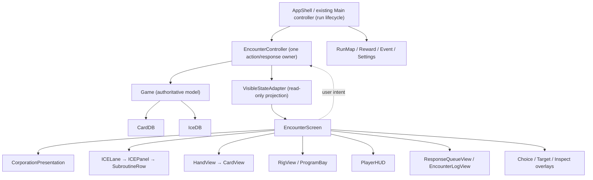

# PANOPTICON — Component Architecture Specification (CAS-001)
**Governing decision:** ARCH-V2-001 · **Date:** 2026-11-23 · **Branch:** `architecture-v2`
**Status: FORMAL PROPOSAL — NOT DESIGNER-APPROVED FOR IMPLEMENTATION.**
**Scope:** Godot 4.3 GL Compatibility; preserve the current HALCYON prototype and approved gameplay.

## 1. Purpose, authority and evidence
Define responsibilities, inputs, outputs, ownership, lifecycle, dependencies, constraints, and validation contracts for a reusable, scene-oriented presentation layer without rewriting the authoritative rules engine.

Source-grounded starting points: `godot/project.godot`, `godot/scenes/Main.tscn`, `godot/scripts/ui/main.gd`, `godot/scripts/ui/friendly_lie/{encounter,card,hand,drop_target,program_bay}.gd`, `godot/scripts/core/{game,cards,ice}.gd`, CI and `docs/architecture-v2/{SCENE_HIERARCHY,DATA_MODEL,GAMEPLAY_INTERFACE,MIGRATION_PLAN,DEPENDENCY_MAP,STATIC_SOURCE_AUDIT}.md`. Exact runtime behavior and signatures must be verified by Claude Code. This document specifies **proposed** boundaries, not files that already exist.

Authority hierarchy: repository governance and approved rules > existing Game semantics > this proposal. Only the designer may approve a specific implementation milestone. No changes to `main`, `release`, gameplay rules, balance, copy approval, reveal guards, or release process.

## 2. Architectural rules
1. `Game` remains the only authority for phase, legality, state mutations, damage, costs, RNG, ICE/subroutine outcomes, rewards and pending choices. `CardDB`/`IceDB` remain definition authorities.
2. One encounter controller owns command dispatch and response-step scheduling. A visual animation may present an already-determined result but must not re-run or advance it twice.
3. Presentation components consume **visible** state and send **intent**, never independently resolve gameplay. Initially, existing widgets may continue querying Game during the compatibility phase; replacing this with snapshots is a **migration goal**, not an instant invariant of legacy code.
4. Use typed GDScript and `.tscn` for meaningful reusable screens/complex widgets; lightweight GDScript or Theme resources for small elements. No scene per icon, new autoload or global signal bus by default.
5. Preserve card instance UID, existing ICE dictionary/reference identity, pending choice state and existing response ordering. Do not invent a new persistent ICE ID until its compatibility is established.
6. Visual profiles are cosmetic; do not duplicate rule values, hidden information, or editorial approval.
7. Keep current `Main.tscn` entrypoint and legacy encounter path as a comparison fixture until deterministic and interactive parity are demonstrated.

## 3. Proposed runtime ownership

This is the **target conceptual ownership**. At the first milestone, the existing `main.gd` and `FriendlyEncounter` remain in place; `EncounterController` and `VisibleStateAdapter` may be functions/interfaces within existing code rather than new scripts.

### Component contract notation
- **Input**: data/context received, not authoritative ownership.
- **Output**: UI intent, signals or presentation events; a signal name is a *candidate*, not an approved Godot signature.
- **Lifecycle**: create/bind/refresh/dispose and state retained.
- **Dependencies**: allowed dependencies in target design; current legacy coupling is separately noted.

## 4. Formal component contracts

### C01 — AppShell / RunCoordinator
**Kind:** screen shell, eventually `.tscn`; **initial implementation:** existing `Main.tscn` + `main.gd`.
**Owns:** navigation, Game instance lifetime, transitions between map/encounter/reward/event, presentation settings and screen mounting.
**Input:** user navigation intents, Game phase and run progression, saved local settings.
**Output:** current screen/context, new-run/enter-node requests to existing Game methods, lifecycle notifications to active screen.
**Does not own:** damage, rewards, turn logic, card legality, response effects.
**Lifecycle:** created once at app launch; swaps screens on Game phase changes; cancels/detaches view-only interactions on screen change; Game survives view rebuild.
**Dependencies:** Game, encounter controller, screen factories; no corporation-specific rules in shell.
**Evidence/concern:** current `main.gd` also implements most UI and response timing; split only after tests.

### C02 — EncounterController / ActionCoordinator
**Kind:** typed GDScript controller/service, not necessarily a Node or separate file.
**Owns:** single dispatch boundary for player intents; target resolution, action sequencing, in-flight response lock and calling existing Game API exactly once.
**Input:** intent with action kind, card UID / current ICE reference / subroutine index / choice payload; current Game state.
**Output:** action result (accepted/rejected, reason), state refresh request and presentation-only effect notifications.
**Does not own:** legality calculations, game outcomes, independent RNG, card definition rules.
**Lifecycle:** bound to current encounter; rejects stale inputs after encounter change; resets view-only selection on transitions; never resets Game state on visual disposal.
**Dependencies:** Game, existing main response coroutine during compatibility stage; adapter only for output.
**Critical constraint:** legacy drop-target drag calls `Game.break_sub` directly while click uses `main._on_break`. Migrate both paths together, with equivalence tests; avoid dual dispatch. Proposed public action vocabulary: `play_card(uid,target)`, `break_sub(ice_ref,sub,pick_uid)`, `choose(kind,payload)`, `end_turn()`, `boost(uid)`. **Not approved signatures.**

### C03 — ResponseSequencer
**Kind:** controller responsibility, **not** a second independent rules engine.
**Owns:** ordering of presentation pauses/flash cues and exactly one invocation per existing `Game.response_step()`, then `response_finish()`.
**Input:** Game response queue and phase; reduced-motion preference; screen lifecycle state.
**Output:** per-step visual cue, updated visible state, final completion signal.
**Does not own:** effect resolution, preview rerolls, damage arithmetic or extra queue.
**Lifecycle:** starts only on valid response; retains in-flight state until Game reaches an allowed phase; interruption policy must be verified before changing coroutine; reduced-motion changes duration, never Game outcome.
**Dependencies:** Game and local presentation timing. No signal bus or independent queued effects.
**Evidence:** current `main._play_response` awaits timers, calls `response_step` per queued step, then `response_finish`; its exact interruption semantics are **NOT VERIFIED**.

### C04 — VisibleStateAdapter
**Kind:** pure typed helper or local adapter (candidate; not yet implemented).
**Owns:** read-only projection of Game state into UI-safe data; stable identity handles, display-ready status, currently visible subroutines and available-action feedback from existing Game queries.
**Input:** Game instance, current selection, existing copy/reveal policy, cosmetic profile references.
**Output:** transient `EncounterViewSnapshot` and legality descriptors; snapshots cannot mutate Game.
**Does not own:** independent legality, gameplay cache that becomes authority, hidden VOID details or unapproved copy.
**Lifecycle:** rebuild on authoritative state change; avoid caching stale mutable arrays; no save serialization initially.
**Dependencies:** Game, CardDB/IceDB for approved display metadata, existing copy guards.
**Acceptance:** hidden content absent, not merely visually obscured; duplicate card IDs retain distinct UIDs; ICE handles survive reorder/insert or are invalidated safely.

### C05 — EncounterScreen
**Kind:** reusable `.tscn` scene candidate.
**Owns:** encounter presentation layout, child scene composition, visual focus and local animations, dispatch of child intents to controller.
**Input:** visible snapshot, visual profile, presentation preferences, controller interface.
**Output:** intent signals (play, target, break, choice, end turn), no direct gameplay mutation in target design.
**Does not own:** Game lifetime, encounter phase or reward resolution.
**Lifecycle:** mount on encounter; bind before render; refresh without invalidating active drag/focus; teardown on transition with no extra rules calls.
**Dependencies:** controller, adapter outputs, component scenes, cosmetics. Legacy compatibility may wrap `FriendlyEncounter` first.
**Acceptance:** one playable ICE encounter with card interaction, response, choice and completion; same state as legacy for identical actions.

### C06 — CorporationPresentation
**Kind:** composite view and cosmetic profile resource.
**Owns:** background, mascot/ICE art treatment, approved typography, palettes, chrome/CRT effects, sound/animation cue selection.
**Input:** corporation ID, cosmetic profile, approved reveal/copy state and reduced motion.
**Output:** visuals/audio only.
**Does not own:** ICE strength/subroutines, card effects, Game rules, copy approval or reveal conditions.
**Lifecycle:** swap profile without reconstructing Game; load/unload visual assets with screen.
**Dependencies:** existing `CorporationSkin`/themes and approved copy system; profile schema proposed separately.
**Acceptance:** second corporation look uses identical encounter component and rules path; no hidden information leakage.

### C07 — ICELane
**Kind:** container scene candidate.
**Owns:** ordered layout of ICE panels, insertion/removal animation, spatial targeting context.
**Input:** visible ordered ICE list and stable current handles.
**Output:** forwards selected ICE/subroutine intent.
**Does not own:** encounter array mutations or resolving ICE order.
**Lifecycle:** reconcile children by identity, not mutable array position; remove stale targets safely.
**Dependencies:** ICEPanel and EncounterScreen.
**Acceptance:** insert, rotate, reorder and encounter transition do not retarget user actions.

### C08 — ICEPanel
**Kind:** reusable `.tscn` candidate (first likely extracted leaf).
**Owns:** one ICE's visual frame, portrait, strength display, current visible subs, hover and target highlighting.
**Input:** ICE display model, visual profile, selection and animation state.
**Output:** `ice_selected(handle)`, `subroutine_selected(handle,sub)`, drop intent.
**Does not own:** break legality, strength mutations, subroutine effects or hidden subroutine contents.
**Lifecycle:** bind/rebind to one live identity; clear stale state on recycling; no Game mutations on animation callbacks.
**Dependencies:** SubroutineRow and cosmetics; target design does not import Game.
**Acceptance:** current active TUMBLER slots and broken-state feedback match prototype.

### C09 — SubroutineRow
**Kind:** lightweight reusable UI element; scene only if complexity warrants.
**Owns:** one visible subroutine's effect text, status, target feedback and input affordance.
**Input:** display-safe effect(s), slot identity, current allowed action feedback.
**Output:** click/drag/keyboard intent for that subroutine.
**Does not own:** break cost or damage computation.
**Lifecycle:** rebind on active-slot rotation; drop stale targets.
**Dependencies:** ICEPanel, approved display strings and cosmetics.
**Acceptance:** multiple effects in one subroutine render correctly without revealing hidden effects.

### C10 — HandView
**Kind:** composite view; initially preserve `FriendlyHand`.
**Owns:** card layout/fan, focus navigation, ordering and scroll/hover interaction.
**Input:** hand card snapshots with unique instance UIDs and selection.
**Output:** card selected, card dragged, keyboard activation.
**Does not own:** draw/discard, card cost, hand size limit.
**Lifecycle:** preserve focus/drag across safe refresh; reset on hand removal or phase change.
**Dependencies:** CardView, EncounterScreen.
**Evidence:** `FriendlyHand` already supports wheel/keyboard navigation; currently Enter calls controller through card.view.ui.

### C11 — CardView
**Kind:** reusable visual control/scene; initially preserve `FriendlyCard`.
**Owns:** artwork, card name/rules presentation, cost badge, rarity treatment, hover, drag ghost, selected glow, inspection request.
**Input:** card definition display data, **instance UID**, visible playability feedback, cosmetic profile.
**Output:** click/drag/inspect intent with UID.
**Does not own:** cost payment, card effect, target legality or discard.
**Lifecycle:** rebind on card movement; no identity from card definition ID alone.
**Dependencies:** HandView, cosmetic resources, controller intent boundary.
**Evidence:** existing `FriendlyCard` queries `view.game.can_play` and `view.ui`; removing these direct references requires parity tests.

### C12 — RigView / ProgramBay
**Kind:** composite view; preserve `FriendlyProgramBay` initially.
**Owns:** installed-program presentation, active breaker selection, drag acceptance feedback and install/uninstall intent.
**Input:** installed-program snapshot, current BW/RAM, Game-derived legality feedback.
**Output:** program selected, install/uninstall, boost and break intent.
**Does not own:** installation legality, resource limits or breaker strength math.
**Lifecycle:** reconcile installed instances by UID; reset selection if removed.
**Dependencies:** CardView or program visual, controller; legacy bay directly calls `Game.can_play`.

### C13 — PlayerHUD
**Kind:** reusable composite view.
**Owns:** VITAE, BW, RAM, CRED, TRACE, turn/phase readouts, accessible status announcements.
**Input:** read-only visible resource values and status.
**Output:** optional inspection/help intent only.
**Does not own:** resource values or counters.
**Lifecycle:** refresh after every Game action; avoid animation tween overwriting real values.
**Dependencies:** EncounterScreen and Theme.

### C14 — ResponseQueueView / EncounterLogView
**Kind:** two lightweight views (may share a panel; no forced separate scenes).
**Owns:** presentation of *approved visible* queued responses, step highlights, history and accessible text.
**Input:** adapter-filtered queue, step cue and visible Game log.
**Output:** inspection or scroll intent.
**Does not own:** queue progression or effects.
**Lifecycle:** append/reconcile without replaying events or duplicating sound.
**Dependencies:** adapter, ResponseSequencer presentation notifications.

### C15 — ChoiceOverlay
**Kind:** shared modal scene candidate.
**Owns:** display of currently valid choice candidates, focus trap, selected-card glow, commit/cancel affordance only where allowed.
**Input:** Game-derived pending choice kind, valid candidate UIDs/ICE handles, visible explanation.
**Output:** selected IDs/choice intent to controller.
**Does not own:** choice legality, card discard or effect resolution.
**Lifecycle:** open only for pending choice; close after confirmed resolution; do not auto-commit when closing or rebuilding.
**Dependencies:** EncounterScreen, controller, CardView; must support existing choice variants rather than assuming all are discard.

### C16 — Targeting / Inspection / Settings overlays
**Kind:** shared view components, initially existing code.
**Owns:** target highlights, full card/ICE inspection, local audio/reduced-motion/display preferences.
**Input:** visible model, active selection, existing approved copy, settings.
**Output:** target selection, close/inspect, presentation setting change.
**Does not own:** target legality, gameplay state or save schema.
**Lifecycle:** close/clear on phase or encounter change; inspection never reveals hidden content.
**Dependencies:** AppShell/EncounterScreen and adapter.

### C17 — RunMapScreen, RewardScreen, EventScreen
**Kind:** future reusable screen scenes, **out of scope for first playable encounter**.
**Owns:** navigation and display for their respective phases; reward choice UI.
**Input:** Game-derived phase and visible choices.
**Output:** navigation/reward selection intent to existing Game API.
**Does not own:** map routing, reward pool generation, progression or RNG.
**Lifecycle:** AppShell mounts one active screen; discard view-only state on transition.
**Dependencies:** AppShell, controller and visible state adapter. Do not implement until later gated milestone.

### C18 — PresentationResources
**Kind:** Godot Theme, existing `CorporationSkin` and possible cosmetic-only `.tres`/JSON profiles.
**Owns:** art references, palette, font, material, sound and visual animation presets.
**Input:** approved cosmetic assets and editorial metadata.
**Output:** render configuration only.
**Does not own:** card costs, ICE STR, subroutine definitions, hidden effects, copy approvals.
**Lifecycle:** loaded as needed, immutable during gameplay; no save migration in first milestone.
**Dependencies:** existing themes/assets; do not migrate CardDB/IceDB.

## 5. Allowed dependency directions and forbidden shortcuts
| From | Allowed target | Forbidden |
|---|---|---|
| AppShell | controller, Game lifecycle, screens | per-card damage/effect logic |
| EncounterController | Game API, response scheduler, visible-state adapter | independent rules/RNG |
| VisibleStateAdapter | read-only Game queries, existing copy gates | mutating Game; leaking hidden state |
| EncounterScreen | child views, controller intents, snapshots | direct rules resolution in target architecture |
| ICEPanel/CardView/HandView | parent intent interface, cosmetic resources | writing Game; global singleton |
| CorporationPresentation | visual profiles, approved visible copy | modifying rules or reveal state |
| Game | CardDB, IceDB and existing core dependencies | scene/UI classes |

**Compatibility exception:** existing legacy widgets currently read Game and call main directly. The first milestone must preserve these paths until a tested redirection is approved. Do not declare them compliant with the target boundary prematurely.

## 6. Command and snapshot contracts (illustrative, not executable signatures)
```text
InputIntent:
  action_kind: PLAY_CARD | BREAK_SUB | CHOOSE | END_TURN | BOOST | INSPECT
  card_uid?: existing unique instance UID
  ice_handle?: live encounter-scoped ICE reference
  sub_index?: current visible subroutine slot/index
  payload?: existing choice data

ActionResult:
  accepted: boolean
  reason?: Game-derived failure reason
  game_phase_after: current Game phase
  refresh_required: boolean

EncounterViewSnapshot:
  encounter_epoch: view-only encounter identity token (not a new Game ID)
  phase, visible_resources, visible_ice[], hand_cards[], installed_programs[]
  pending_choice?: visible valid choices
  response_cues?: approved visible queue/step
  corporation_visual_profile: cosmetic reference
```
**Important:** current `Game` uses ICE array indices in action methods and dictionary references in drag targets. The controller must resolve a current index at dispatch time, verify it belongs to the same encounter and reject stale targets. Do not assume Godot `Array.find` provides persistent object identity without a test. This is a proposed adapter, not a gameplay schema change.

## 7. Component lifecycle / event ordering
```text
Launch → AppShell creates Game → select/start run
  → enter encounter → controller binds existing Game
  → adapter builds visible state → EncounterScreen binds components
  → input event → controller validates current context → ONE Game action
  → read state/events → adapter refresh → components reconcile
  → end turn → ONE ResponseSequencer advances Game.response_step per queued item
  → Game.response_finish ONCE → refresh and transition if needed
  → encounter exit → clear drag/focus/tweens → dispose views, retain Game
```
Animation timing and interrupted response must be tested before altering the existing coroutine. UI refresh must not replay effects, generate extra Game actions or invalidate active drag target without rejection.

## 8. Minimal implementation proposal and dependencies
**Phase 0 (Claude Code):** pin baseline SHA, verify Godot 4.3 and headless tests, investigate skipped CORE_LOOP screenshot fixtures, record actual display and Windows evidence separately. No architecture implementation.

**Phase 1 (Claude Code):** verify call graph, component boundaries, lifecycle, hidden-copy gates and choice variants; decide whether wrapper-first is safer than extracting a leaf directly; produce first-milestone exact files and test plan. Stop for designer approval.

**Phase 2A (only after approval):** preserve `Main.tscn`, `main.gd`, `Game`, legacy `FriendlyEncounter`, `FriendlyCard`, `FriendlyHand` and drop targets. Introduce at most one isolated `EncounterScreen` wrapper (if justified) and active CORE_LOOP screenshot/interaction fixture. No gameplay changes.

**Phase 2B (separate gated increment):** normalize one player action dispatch path (card click/drop or ICE break click/drag), compare deterministic state and costs, then extract one reusable ICEPanel or other evidence-selected component. Do not migrate every widget at once.

**Phase 3:** reuse same scene with a second corporation visual profile and no duplicate rules/UI. **Phase 4:** map, reward, events and settings after parity.

### Candidate file plan — for review only
```text
godot/scenes/Main.tscn                       [retain]
godot/scripts/ui/main.gd                     [retain; minimal approved integration]
godot/scripts/ui/friendly_lie/*.gd           [retain legacy parity path]
godot/scripts/core/{game,cards,ice}.gd       [unchanged]
godot/scenes/architecture_v2/EncounterScreen.tscn  [candidate]
godot/scripts/ui/architecture_v2/encounter_screen.gd [candidate]
godot/scripts/ui/architecture_v2/visible_state_adapter.gd [optional, later]
godot/scenes/architecture_v2/ICEPanel.tscn    [candidate after parity]
godot/scripts/ui/architecture_v2/ice_panel.gd [candidate after parity]
godot/tests/test_arch_v2_parity.gd            [candidate]
godot/tests/shot_arch_v2_encounter.gd         [candidate]
```
These paths are illustrative and **must not be created solely because they appear here**.

### Typography and motion dependency (UI-TYPO-001 / UI-TYPO-001a)

The [parallel M06 milestone](../REDLINE_MASTER_DESIGN.md#typography--motion-design-system-milestone-m06--priority-1-companion) provides presentation requirements for the Priority 1 representative encounter. Review the event inventory and motion prototypes alongside the first-slice contract review. C02–C05 and C18 are candidate seams for presenting already-resolved visible events with reusable visual resources. Review placements and payloads with the owners of the ICE and subroutine views (C07–C09), card and rig views (C10–C12), HUD (C13), response context (C14), and reward presentation (C17). Cover phase and encounter transitions, action and ICE outcomes, resource and TRACE deltas, and approved extraction and acquisition feedback available in the slice.

Review event identity and order, visible text/value source, component anchor, priority/consolidation, interruption and reduced-effect behavior. Keep presentation scheduling independent of C03's gameplay response sequencing. The same authoritative action resolves once with any presentation setting. A playback completion signal cannot advance rules; overlays must preserve required input, readable state and copy/reveal guards. Validate competing events and reduced effects with actual encounter events under the existing parity and fixture gates. Specific scene boundaries and signatures remain proposals for review in CAS-001 and [#21](https://github.com/Punkwork/REDLINE/issues/21), with UI work in [#24](https://github.com/Punkwork/REDLINE/issues/24).

## 9. Verification and acceptance matrix
| Contract | Required evidence |
|---|---|
| Baseline | Exact `main` SHA, pinned Godot binary, tests and logs; tag status truthful |
| One-action rule | Click vs drag: identical seeded Game state, logs and resource costs |
| Response sequencing | Queue steps and finish occur once; identical outcome with reduced motion on/off |
| ICE identity | Stale ref, inserted ICE, rotated TUMBLER, encounter transition correctly handled |
| Card identity | Duplicate card IDs, compiled/grafted cards retain instance UID |
| Choice overlay | All existing pending choice variants resolve once; no accidental cancel/commit |
| Visible state | Hidden VOID and SIGNAL-001 gated copy never appear in snapshots or tooltips |
| Visual parity | Current CORE_LOOP fixture exercises mouse, keyboard, drag/drop, focus and refresh |
| Accessibility | ≥4.5:1 text contrast, readable scaling, reduced motion and alternate input |
| Second corporation | Same encounter scene, cosmetic profile swap only, no duplicated rules |
| Windows | Export artifact distinct from genuine Windows interaction test |

No test is marked passed by this specification.

## 10. Decisions requiring designer review
1. Approve or revise the component ownership map (C01–C18).
2. Wrapper-first vs first leaf extraction after Claude Code baseline audit.
3. Whether the action coordinator remains in `main.gd` initially or becomes a separate typed class.
4. Whether `VisibleStateAdapter` is a separate class in Phase 2 or introduced later.
5. Which encounter and exact action sequence form the parity fixture.
6. Cosmetic resource format and second-corporation skin scope.
7. Response interruption behavior and how to verify it without altering gameplay.
8. First milestone exact file list, CI coverage and rollback conditions.

**Review gate:** Claude Code checks these proposals against running Godot and actual tests; designer approves/revises the specific milestone before code implementation. This specification is not an authorization to build.
