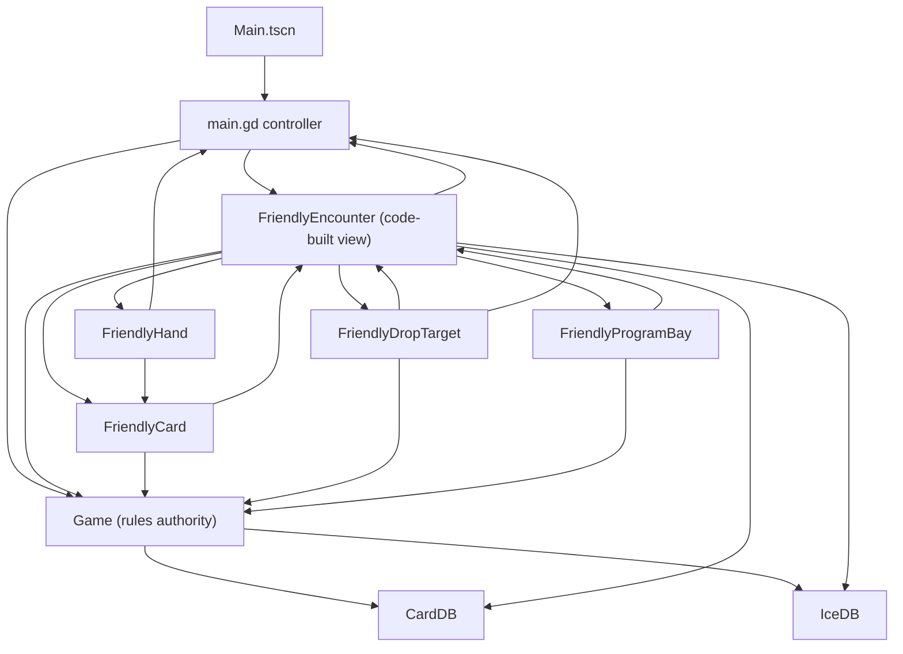

# PANOPTICON — Source-grounded dependency map
**ARCH-V2-001 · 2026-11-23 · Static review / PROPOSED migration, not approved implementation**

## Evidence and scope
Inspected `Main.tscn`, `main.gd`, `friendly_lie/{encounter,card,hand,drop_target,program_bay}.gd`, `core/{game,cards,ice}.gd` and CI at the `architecture-v2` branch. Source line numbers are approximate and must be rechecked after pull. This is not an exhaustive import graph, runtime trace or test execution.

## Directed dependencies (caller → callee)

This diagram emphasizes confirmed references and dispatch paths; not every arrow is a direct class import. It intentionally distinguishes bidirectional runtime references from static imports.

## Concrete interaction paths
| User operation | Observed call path | Risk |
|---|---|---|
| Card click | `FriendlyCard._card_input` → `view.ui._on_card(uid)` → `main.play_seated_card` → `Game.play_card` | Controller knowledge embedded in card |
| Card drag | `FriendlyCard._get_drag_data` → `FriendlyEncounter.begin_drag` → drop target or encounter `_drop_data` → `main.play_seated_card` → `Game.play_card` | Distinct click/drop paths must remain equivalent |
| Program install | `FriendlyProgramBay._drop_data` → `main.play_seated_card` → `Game.play_card` | Bay directly queries CardDB and Game for legality |
| Break key click | `FriendlyDropTarget._gui_input` → `FriendlyEncounter.break_action` → `main._on_break` → `Game.break_sub` | Selection and active pick choice occur in view |
| Break key drag | `FriendlyDropTarget._drop_data` → **direct** `Game.break_sub` | Bypasses main action wrapper; new adapter must not double-dispatch |
| Targeted card | `main._on_card` sets targeting UID; ICE click routes `main._on_ice_clicked` → `Game.play_card(uid, ice_index)` | Target identity and pending choice are separate cases |
| End turn response | `main._play_response` → await timer → `Game.response_step` per queued effect → await timer → `Game.response_finish` | UI timing is intertwined with game-step sequencing |
| Refresh | `main.refresh` → `FriendlyEncounter.sync(Game)` → `build_rig`, `build_ice`, `build_hand` | Full rebuilding can invalidate UI references and in-flight animation |

## Coupling and ownership observations
- `main.gd` is both the owner of the `Game` instance and a multi-screen presentation controller. It constructs `FriendlyEncounter` at approximately line 2017 and injects `friendly.ui = self`.
- `FriendlyEncounter` keeps `ui` and `game` references; `sync(model: Game)` reads mutable game state and rebuilds multiple visual groups.
- `FriendlyCard` reads `view.game.can_play`, dispatches through `view.ui`, and calls `view.hand.focus_card`; card presentation is not fully independent of encounter context.
- `FriendlyHand` contains reusable layout/keyboard behavior, but Enter routes through `card.view.ui._on_card`.
- `FriendlyDropTarget` stores `ice_ref: Dictionary` and derives the live ICE index with `game.enc.ice.find(ice_ref)`. This is safer than caching an index but requires tests for stale references, duplicate dictionaries and encounter transitions.
- `FriendlyProgramBay` validates using `CardDB.def` and `Game.can_play`, then dispatches through the main controller.
- `Game` has explicit action methods and CardDB/IceDB remain definition authorities. Avoid duplicate rule logic in UI or cosmetic resources.

## Migration seams and recommended extraction order (PROPOSED)
1. **Observe and baseline:** instrument deterministic game state before/after actions and map the response coroutine; add active CORE_LOOP UI smoke evidence because CI currently skips legacy screenshot fixtures.
2. **Wrap current encounter:** create a scene shell only after approval, retaining the current `Game` instance, main controller and existing `FriendlyEncounter` path. This tests lifecycle without changing rules.
3. **Normalize input dispatch:** design a local, explicit controller interface for card play, ICE targeting, break, choice and response; compare click and drag outcomes before redirecting existing controls.
4. **Extract one leaf presentation unit:** choose ICEPanel or another component based on actual reuse and test coverage; do not migrate hand, rig and overlays simultaneously.
5. **Cosmetic corporation profile:** reuse the same encounter scene with a different cosmetic profile, retaining Game/CardDB/IceDB unchanged.
6. **Migrate additional screens incrementally:** map, rewards, overlays and settings after parity evidence and designer review.

## Interface contract candidates (not approved)
| Concern | Existing authority | Proposed boundary |
|---|---|---|
| Card legality and payment | `Game.can_play`, `Game.play_card` | View requests action by stable card UID |
| ICE targeting | `Game.enc.ice`, `Game.break_info` | View resolves current ICE reference before dispatch |
| Response progression | `Game.response_step/finish`, main coroutine | Single owner for step scheduling; animations observe state |
| Card/hand focus | FriendlyCard/FriendlyHand | Keep UI-only focus state within components |
| Resource counters | Game state | Read-only snapshot, not parallel mutable values |
| Copy/reveal | Existing copy guards and Game state | Explicit visible-state filter before render |

## Immediate Claude Code validation questions
1. Are `Game.response_step` and `response_finish` safe under reduced motion, screen exit and interruption? Trace exact call sites and state transitions.
2. Which functions inside `FriendlyEncounter.sync` rebuild nodes while dragging, inspecting or animating? What lifecycle guarantees exist?
3. Can two ICE dictionaries compare equal such that `Array.find(ice_ref)` selects the wrong target? Inspect creation and identity semantics; test inserted ICE and encounter changes.
4. Are all actions accessible by keyboard and mouse after wrapping the current view?
5. Which current CORE_LOOP screenshots and interaction tests actually run in CI? Distinguish skipped from passed.
6. Does a wrapper scene add measurable value before a leaf extraction, or would a smaller isolated view be safer? Provide evidence.
7. What existing tests assert parity of card click versus card drag and pick click versus pick drag?
8. Which code paths render hidden information and SIGNAL-001 reveals, and how can the new view avoid bypassing those guards?

**Status:** No code changed, no tests run, no approval for new scene paths. Designer review is required before implementation.
