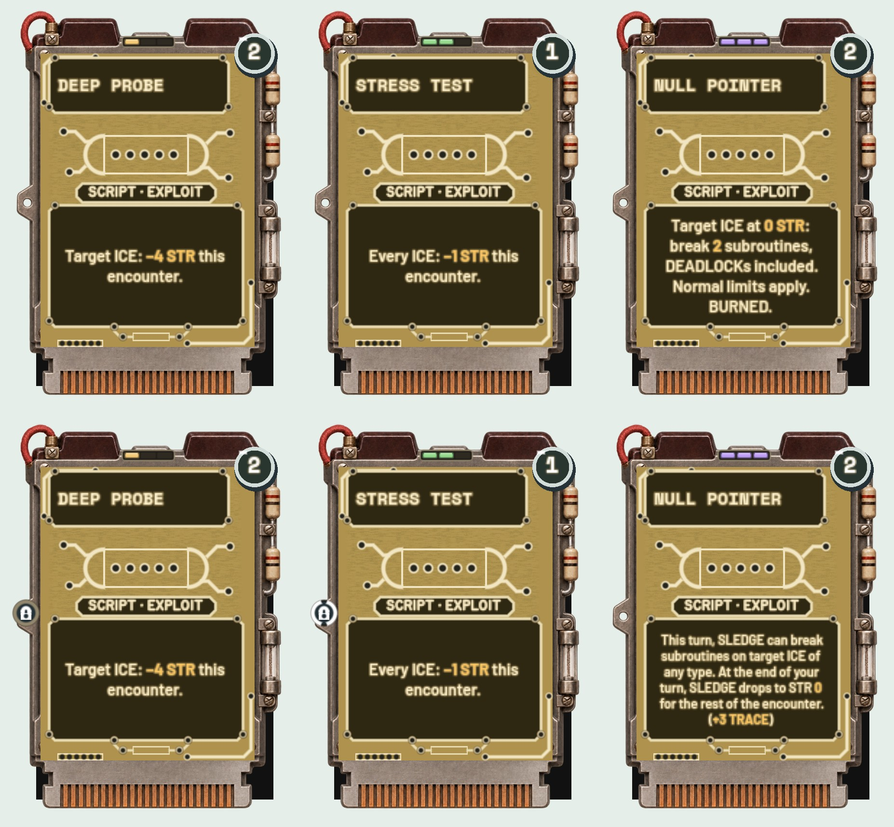

# CARDS-002 — Mustard PCB cartridge review

**Review branch only.** This folder lives on `review/cards-002` and is never merged into `main` or `release` (designer, 2026-11-19). Nothing here is part of the playable build.

**Status:** Design review, 2026-11-19. The fifth design is an alternate Rustler cartridge treatment. The review source is isolated from the playable build.



## Current review version — glow study (2026-11-19, PROPOSED)

The designer found that dark text on bare mustard lacked contrast and asked whether the text should glow off the board. In this study no text sits directly on the mustard.

- The board stays mustard laminate `#AE924D`, sampled from the designer's TV Typewriter PCB reference, with its circuit stencil, traces and contacts.
- **Dark solder-mask panels** in `#2E2712` sit behind the title, the type stamp and the rules. The mask is 4.96:1 against the mustard, so each panel reads as a distinct printed area.
- **Glowing ivory text** `#FFF3D0` (13.4:1 on the mask) has a soft zero-offset halo, `rgba(255, 219, 140, 0.32)`. The halo is decoration only; contrast is measured on the solid ink.
- **Title:** Chrome Deco bold, centred vertically in a 124 × 38 chamfered mask panel with plated corner holes. The old dark outline and separator line are gone.
- **Type stamp:** Routed Gothic, one centred line (`SCRIPT · EXPLOIT`) at 9 px, falling to 8 px if needed, on a small pill-shaped mask plate. The plate has no plated holes, so nothing touches the letters.
- **Rules:** Barlow SemiBold, centred in a fixed 134 × 84 mask panel with traces, plated holes and the empty resistor footprint, at 11 px down to a 9 px floor. Numbers and their units are **Barlow Bold in phosphor amber** `#FFC861` (9.7:1 on the mask).
- **Rarity:** a recessed light in the top exterior of the cartridge with three cells, filled left to right: one for Common, two for Uncommon, three for Rare. The card face omits the written rarity; the hover tooltip still names it.
- **Cached** is never printed on the card. A padlock indicator is mounted on the cartridge's left ear, outside the board. A card held until played has a solid rim. A temporary cache breaks the rim into segments, one lit per remaining turn. The hover tooltip reads `CACHED` or `CACHED · TEMP (n turns)`.

| Rarity | Light | Example |
|---|---|---|
| Common | Warm amber `#F5CA76`, 1 cell | [DEEP PROBE](captures/DEEP_PROBE.png) |
| Uncommon | Phosphor green `#94D98C`, 2 cells | [STRESS TEST](captures/STRESS_TEST.png) |
| Rare | Soft violet `#BF9EF6`, 3 cells | [NULL POINTER](captures/NULL_POINTER.png) |

| State | Capture |
|---|---|
| Cached until played | [DEEP PROBE, cached](captures/DEEP_PROBE_CACHED.png) |
| Temporary cache, 2 turns left | [STRESS TEST, cached · temp](captures/STRESS_TEST_CACHED_TEMP.png) |
| Longest rules in the pool (SLEDGE, 155 characters) at the 9 px floor | [Stress card](captures/LONGEST_RULES_STRESS.png) |

The captures are at 3× hand size. [`captures/hand-size/`](captures/hand-size/) holds the same six cards rendered at hand size (164 × 244 on the 1600 × 1000 canvas).

## Review fixes (2026-11-19, PROPOSED except where noted)

| Issue in the first review | Change |
|---|---|
| Printed `CACHED` tag landed inside the fixed rules frame | **Designer direction:** cached is an icon on the outside of the card, not text. Padlock on the left ear; the left edge stays visible when hand cards overlap. |
| Long rules would shrink to about 8 px | Stencil art shortened to 40 px and type plus tags merged to one line, so the frame grows from 67 to 84 px. Floor raised to 9 px; every card's rules at AMP 0–3 (444 texts) fit. |
| Rarity shown by colour alone (amber and green differ by only 1.08:1 in brightness) | Lit-cell count, 1/2/3, alongside the colour. |
| Numbers lost their emphasis | Barlow Bold for numbers in the dark ink (the old `#F2CD87` highlight would fail contrast on mustard). |
| White title is 2.99:1 on mustard alone | Superseded by the glow study: the title sits on its own dark mask panel. |
| Thin left-aligned type lines crowding the frame | One centred stamp line with a weighting outline, at least 3 px clear of the frame. |

## Design sequence

1. [Initial four-type palette](iterations/PANOPTICON_Card_Palette.jpg)
2. [Fifth design with a full mustard face](iterations/PANOPTICON_Mustard_PCB_05.jpg)
3. [White lettering study](iterations/PANOPTICON_Mustard_PCB_05_White.jpg)
4. [White title and dark rules text](iterations/PANOPTICON_Mustard_PCB_05_Split_Ink.jpg)
5. [Higher-contrast rules study](iterations/PANOPTICON_Mustard_PCB_05_High_Contrast.jpg)
6. [Small-print typography comparison](iterations/PANOPTICON_PCB_Lettering_Specimens.jpg)
7. [Routed Gothic, Barlow SemiBold and solder border](iterations/PANOPTICON_Mustard_PCB_05_Solder_Border.jpg)
8. [Fixed frame and centred rules](iterations/PANOPTICON_Mustard_PCB_05_Centered_Rules.jpg)
9. [Board traces, plated holes and resistor footprint](iterations/PANOPTICON_Mustard_PCB_05_Board_Trace_Frame.jpg)
10. [Top-edge rarity lights](iterations/PANOPTICON_Mustard_PCB_05_Rarity_Lights.jpg)
11. [Review fixes: cache padlock, segmented lights, taller frame, bold numbers](iterations/PANOPTICON_Mustard_PCB_05_Review_Fixes.jpg)
12. [Glow study: ivory text on dark solder-mask panels, amber numbers](iterations/PANOPTICON_Mustard_PCB_05_Glow_Mask.jpg)

## Reproduce the latest preview

Use Godot 4.3 and a disposable checkout at the CARDS-002 baseline `0aa6091dd163aed97753686b4fea133812c053b0`. Set `review_source` to the absolute path of this review folder's `source/` directory before running the commands from the root of the disposable checkout.

```bash
git apply "$review_source/card.gd.patch"
cp "$review_source"/fonts/*.ttf godot/assets/fonts/
cp "$review_source/shot_typeface_preview.gd" godot/tests/

preview_dir="$(mktemp -d)"
export SHOT_DIR="$preview_dir/screenshots" XDG_DATA_HOME="$preview_dir/user-data"
mkdir -p "$SHOT_DIR" "$XDG_DATA_HOME"
godot --headless --path godot --editor --import --quit
godot --audio-driver Dummy --rendering-driver opengl3 --path godot \
  --script res://tests/shot_typeface_preview.gd
# Hand-size captures (written with a _1x suffix):
PREVIEW_SCALE=1 godot --audio-driver Dummy --rendering-driver opengl3 --path godot \
  --script res://tests/shot_typeface_preview.gd
```

The capture fixture needs a display. It checks:

- each lamp's tier and lit-cell count against the card's actual rarity;
- the fixed frame, the 9 px floor, centring and fit of the rules, and bold numbers;
- that the type stamp is one line and clear of the frame;
- that the title, type stamp and rules each sit on the dark mask, in glowing ivory, with every ink at least 4.5:1 on the mask and no plated holes on the type plate;
- that `CACHED` never appears on the card face, and that the padlock appears only on cached cards, stays off the board, shows the right turn count and is named in the tooltip;
- that every card's rules text at AMP 0–3 fits the frame at 9 px, and every Rustler type stamp fits one line at 8 px.

With the patch applied, the rules, ADP and SIGNAL/CARBON suites still pass (361/0, 17/0, 671/0).

The [preview source](source/) includes the patch, fixture and both font licences. [Routed Gothic](https://github.com/dse/routed-gothic/tree/365e340d64c55cb7c57940744773e6c833e3efd9) and [Barlow SemiBold and Bold](https://github.com/google/fonts/tree/main/ofl/barlow) are distributed under the SIL Open Font License; `Barlow-OFL.txt` covers both Barlow weights.
