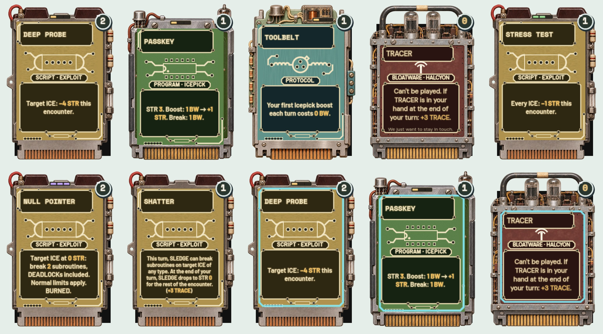

# CARDS-002 — PCB glow cartridges, all four card types

**Review branch only.** This folder lives on `review/cards-002` and is never merged into `main` or `release` (designer, 2026-11-19). Nothing here is part of the playable build.

**Status:** APPROVED by the designer on 2026-11-19 and built on `main` as **CARDS-003** (commit `9354e2f`). This branch stays as the review archive and is never merged; `main` holds the code, the fixture `godot/tests/shot_cards_pcb.gd` and the reference sheets in `docs/visual/fixtures/cards-003/`.



## Current review version: four-type glow treatment

**Palette.** Mustard `#AE924D` replaces SCRIPT's old gold/brown (`#BD9547` with a `#6C4A1D` face). That colour was nearly identical to mustard (hue 40° against 43°), so mustard could not sit anywhere else without leaving two golds side by side. The designer asked Claude to choose.

| Type | Board | Dark mask behind text | Example |
|---|---|---|---|
| SCRIPT | Mustard `#AE924D` (new) | `#2E2712` | [DEEP PROBE](captures/SCRIPT_DEEP_PROBE.png) |
| PROGRAM | Deeper green `#5A8048` (designer direction; replaces olive `#90934F`) | `#172312` | [PASSKEY](captures/PROGRAM_PASSKEY.png) |
| PROTOCOL | Blue-green `#60938A` | `#14272A` | [TOOLBELT](captures/PROTOCOL_TOOLBELT.png) |
| BLOATWARE | Corporate oxide-red face and Whirlwind art (unchanged) | `#2A1411` | [TRACER](captures/BLOATWARE_TRACER.png) |

**Deeper green PROGRAM (designer direction, 2026-11-19).** Olive was only 20° of hue from mustard. The deeper green `#5A8048` sits at hue 101°: 58° from mustard and 68° from blue-green. It is also darker than both, so the three Rustler boards differ in brightness as well as hue. Ivory is 14.8:1 on its mask.

**Treatment, every type**
- **Dark solder-mask panels** sit behind the title, the type plate and the rules. Each mask is a deep tint of its own board colour. No text sits on the bare board.
- **Glowing ivory text** `#FFF3D0` has a soft halo. Numbers print in Barlow Bold phosphor amber `#FFC861`. On every mask, ivory is at least 13.4:1 and amber at least 9.6:1.
- **Rustler type faces:** Chrome Deco bold for titles, Routed Gothic for the type plate, Barlow SemiBold and Bold for the rules.
- **Circuit stencil per Rustler type** (designer direction): SCRIPT has an edge-connector footprint, PROGRAM a DIP chip with pads on both sides and its orientation notch, and PROTOCOL a TO-5 transistor can between two coil inductors.
- **BLOATWARE** keeps the HALCYON corporate fonts for its facade (designer direction). Its footer line ("We just want to stay in touch.") sits in dimmer ivory at the bottom of its rules panel.
- **Layout:** each panel is placed from the type's own board area. The rules panels are 84 px tall for SCRIPT, 80 for PROGRAM, 79 for PROTOCOL and 84 for BLOATWARE, with an 11 px ceiling and a 9 px floor. All 444 card texts (every card, AMP 0–3) fit their own type's panel.
- **Rarity:** a recessed lamp in each Rustler shell's top exterior, with 1, 2 or 3 lit cells (amber, green or violet) for Common, Uncommon and Rare. On PROTOCOL it sits on the relay's lower rail (designer accepted). Starters have no rarity (designer direction), BLOATWARE has no lamp, and no printed rarity remains on any card.
- **Cached** (designer direction): never printed on the card. A cached card shows one solid icy-cyan `#7FE3F0` glow just inside its board edge, the same whether it is temporary or held until played. The glow draws beneath the BW cost and every text panel. The hover tooltip reads `CACHED`, or `CACHED (temporary)` for a timed cache, which the designer kept for now.

| Also captured | |
|---|---|
| Uncommon and Rare lamps | [STRESS TEST](captures/SCRIPT_STRESS_TEST_UNCOMMON.png) · [NULL POINTER](captures/SCRIPT_NULL_POINTER_RARE.png) |
| Longest rules in the pool (SHATTER, 155 characters) | [SHATTER](captures/SCRIPT_SHATTER_LONGEST_RULES.png) |
| Cached on each board | [SCRIPT](captures/SCRIPT_DEEP_PROBE_CACHED.png) · [PROGRAM, temporary](captures/PROGRAM_PASSKEY_CACHED_TEMP.png) · [BLOATWARE](captures/BLOATWARE_TRACER_CACHED.png) |

The captures are at 3× hand size. [`captures/hand-size/`](captures/hand-size/) holds the same cards rendered at hand size (164 × 244 on the 1600 × 1000 canvas).

**Interpretations to confirm**
- The mask tints for each type.
- The footprint chosen for each stencil.

## Design sequence

1. [Initial four-type palette](iterations/PANOPTICON_Card_Palette.jpg)
2. [Fifth design with a full mustard face](iterations/PANOPTICON_Mustard_PCB_05.jpg)
3. [White lettering study](iterations/PANOPTICON_Mustard_PCB_05_White.jpg)
4. [White title and dark rules text](iterations/PANOPTICON_Mustard_PCB_05_Split_Ink.jpg)
5. [Higher-contrast rules study](iterations/PANOPTICON_Mustard_PCB_05_High_Contrast.jpg)
6. [Small-print typography comparison](iterations/PANOPTICON_PCB_Lettering_Specimens.jpg)
7. [Routed Gothic, Barlow SemiBold and solder border](iterations/PANOPTICON_Mustard_PCB_05_Solder_Border.jpg)
8. [Fixed frame and centred rules](iterations/PANOPTICON_Mustard_PCB_05_Centered_Rules.jpg)
9. [Board traces, plated holes and resistor footprint](iterations/PANOPTICON_Mustard_PCB_05_Board_Trace_Frame.jpg)
10. [Top-edge rarity lights](iterations/PANOPTICON_Mustard_PCB_05_Rarity_Lights.jpg)
11. [Review fixes: cache padlock, segmented lights, taller frame, bold numbers](iterations/PANOPTICON_Mustard_PCB_05_Review_Fixes.jpg)
12. [Glow study: ivory text on dark solder-mask panels, amber numbers](iterations/PANOPTICON_Mustard_PCB_05_Glow_Mask.jpg)
13. [Cache edge glow: cyan board-edge ring, solid or dashed, with the padlock](iterations/PANOPTICON_Mustard_PCB_05_Cache_Edge_Glow.jpg)
14. [Single cache state: one solid cyan glow, no padlock](iterations/PANOPTICON_Mustard_PCB_05_Cache_Single_Glow.jpg)
15. [All four card types with the glow treatment, mustard on SCRIPT](iterations/PANOPTICON_PCB_Glow_Four_Types.jpg)
16. [Deeper green PROGRAM](iterations/PANOPTICON_PCB_Glow_Four_Types_Deep_Green.jpg)
17. [A circuit stencil per Rustler type](iterations/PANOPTICON_PCB_Glow_Type_Stencils.jpg)

## Reproduce the latest preview

Use Godot 4.3 and a disposable checkout at the CARDS-002 baseline `0aa6091dd163aed97753686b4fea133812c053b0`. Set `review_source` to the absolute path of this review folder's `source/` directory before running the commands from the root of the disposable checkout.

```bash
git apply "$review_source/card.gd.patch"
cp "$review_source"/fonts/*.ttf godot/assets/fonts/
cp "$review_source/shot_typeface_preview.gd" godot/tests/

preview_dir="$(mktemp -d)"
export SHOT_DIR="$preview_dir/screenshots" XDG_DATA_HOME="$preview_dir/user-data"
mkdir -p "$SHOT_DIR" "$XDG_DATA_HOME"
godot --headless --path godot --editor --import --quit
godot --audio-driver Dummy --rendering-driver opengl3 --path godot \
  --script res://tests/shot_typeface_preview.gd
# Hand-size captures (written with a _1x suffix):
PREVIEW_SCALE=1 godot --audio-driver Dummy --rendering-driver opengl3 --path godot \
  --script res://tests/shot_typeface_preview.gd
```

The capture fixture needs a display. For every captured card it checks:

- the rarity lamp's tier and 1/2/3 cells, and that no printed rarity remains;
- that each Rustler card carries its own type's circuit stencil, and that BLOATWARE carries none;
- the rules panel's per-type rect, its mask colour, the 9 px floor, centring, fit and bold numbers;
- that the title panel and type plate sit on the type's mask, with glowing ivory text and no plated holes touching the plate's text;
- that every ink is at least 4.5:1 on its mask;
- that `CACHED` never appears on the card face, and that the cyan edge glow appears only on cached cards, follows the type's edge, stays outside every text panel and draws beneath the BW cost.

It also sweeps every card's rules text at AMP 0–3 against its own type's panel, and every type stamp against one line at 8 px.

With the patch applied, the rules, ADP and SIGNAL/CARBON suites still pass (361/0, 17/0, 671/0).

The [preview source](source/) includes the patch, fixture and font licences. [Routed Gothic](https://github.com/dse/routed-gothic/tree/365e340d64c55cb7c57940744773e6c833e3efd9) and [Barlow SemiBold and Bold](https://github.com/google/fonts/tree/main/ofl/barlow) are distributed under the SIL Open Font License; `Barlow-OFL.txt` covers both Barlow weights.
