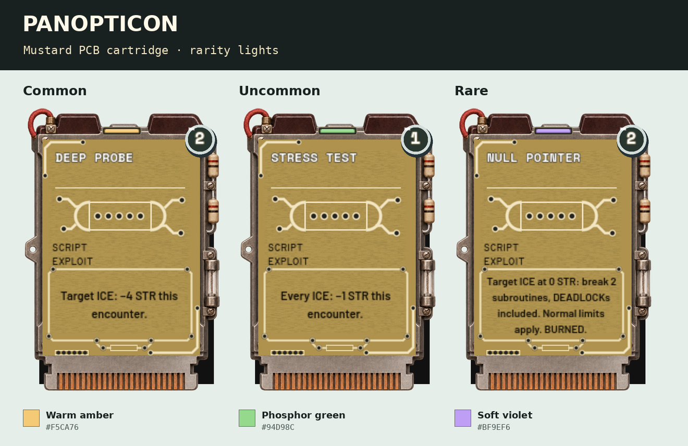

# CARDS-002 — Mustard PCB cartridge review

**Status:** Design review, 2026-11-19. The fifth design is an alternate Rustler cartridge treatment. The review source is isolated from the playable build.



## Current review version

- The whole board uses mustard laminate `#AE924D`, sampled from the designer's TV Typewriter PCB reference. The white title and BW numeral sit above the dark `#100D07` card text.
- Routed Gothic labels the card type and tags. Barlow SemiBold prints the rules. The rules sit directly on the mustard surface inside a fixed-size frame, with each line centred horizontally and the block centred vertically.
- Thin PCB traces outline the entire rules box. Plated through-holes and short branches connect it visually to an empty axial resistor footprint.
- A single recessed light in the top exterior of the cartridge shows rarity. The card face omits the written rarity. The preview applies this treatment to three SCRIPT cards.

| Rarity | Light | Example |
|---|---|---|
| Common | Warm amber `#F5CA76` | [DEEP PROBE](captures/DEEP_PROBE.png) |
| Uncommon | Phosphor green `#94D98C` | [STRESS TEST](captures/STRESS_TEST.png) |
| Rare | Soft violet `#BF9EF6` | [NULL POINTER](captures/NULL_POINTER.png) |

## Design sequence

1. [Initial four-type palette](iterations/PANOPTICON_Card_Palette.jpg)
2. [Fifth design with a full mustard face](iterations/PANOPTICON_Mustard_PCB_05.jpg)
3. [White lettering study](iterations/PANOPTICON_Mustard_PCB_05_White.jpg)
4. [White title and dark rules text](iterations/PANOPTICON_Mustard_PCB_05_Split_Ink.jpg)
5. [Higher-contrast rules study](iterations/PANOPTICON_Mustard_PCB_05_High_Contrast.jpg)
6. [Small-print typography comparison](iterations/PANOPTICON_PCB_Lettering_Specimens.jpg)
7. [Routed Gothic, Barlow SemiBold and solder border](iterations/PANOPTICON_Mustard_PCB_05_Solder_Border.jpg)
8. [Fixed frame and centred rules](iterations/PANOPTICON_Mustard_PCB_05_Centered_Rules.jpg)
9. [Board traces, plated holes and resistor footprint](iterations/PANOPTICON_Mustard_PCB_05_Board_Trace_Frame.jpg)
10. [Top-edge rarity lights](iterations/PANOPTICON_Mustard_PCB_05_Rarity_Lights.jpg)

## Reproduce the latest preview

Use Godot 4.3 and a disposable checkout at the CARDS-002 baseline `0aa6091dd163aed97753686b4fea133812c053b0`. Set `review_source` to the absolute path of this review folder's `source/` directory before running the commands from the root of the disposable checkout.

```bash
git apply "$review_source/card.gd.patch"
cp "$review_source"/fonts/*.ttf godot/assets/fonts/
cp "$review_source/shot_typeface_preview.gd" godot/tests/

preview_dir="$(mktemp -d)"
export SHOT_DIR="$preview_dir/screenshots" XDG_DATA_HOME="$preview_dir/user-data"
mkdir -p "$SHOT_DIR" "$XDG_DATA_HOME"
godot --headless --path godot --editor --import --quit
godot --audio-driver Dummy --rendering-driver opengl3 --path godot \
  --script res://tests/shot_typeface_preview.gd
```

The capture fixture needs a display. It checks each lamp against the card's actual rarity and verifies the fixed frame, text alignment and text fit. The [preview source](source/) includes the patch, fixture and both font licenses. [Routed Gothic](https://github.com/dse/routed-gothic/tree/365e340d64c55cb7c57940744773e6c833e3efd9) and [Barlow SemiBold](https://github.com/google/fonts/tree/main/ofl/barlow) are distributed under the SIL Open Font License.
