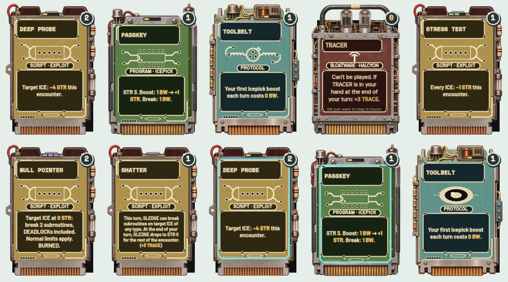
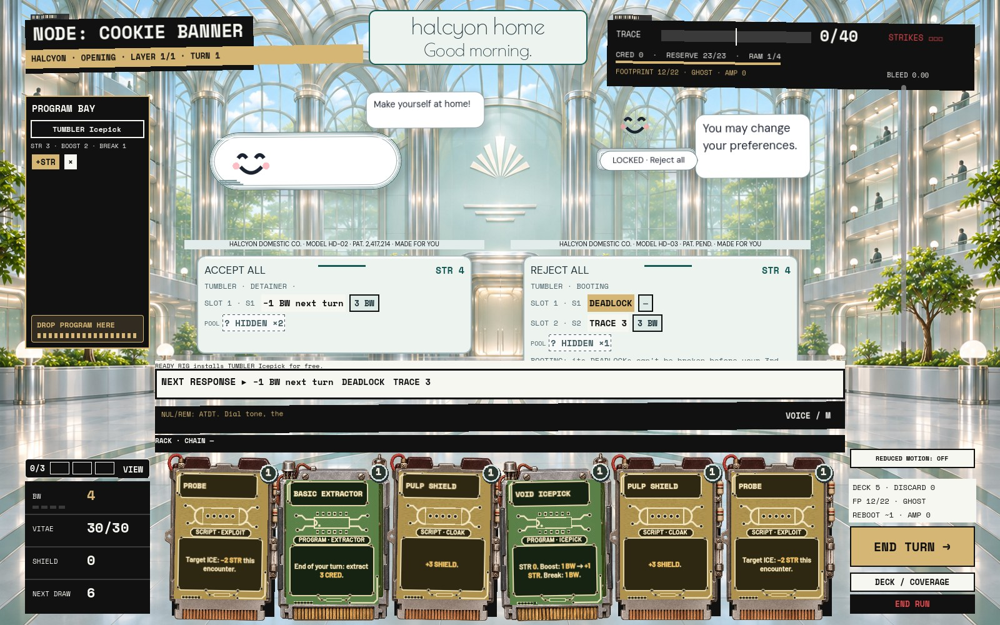

# CARDS-003 — PCB glow cartridges (APPROVED, 2026-11-19)

The playable build uses this card treatment for every card type. The design history (17 iterations, review captures and the preview patch) is archived on the `review/cards-002` branch, which is never merged.

| Type | Board | Dark mask behind text | Circuit stencil |
|---|---|---|---|
| SCRIPT | Mustard `#AE924D` | `#2E2712` | Edge connector |
| PROGRAM | Deeper green `#5A8048` | `#172312` | DIP chip |
| PROTOCOL | Blue-green `#60938A` | `#14272A` | TO-5 can between two coils |
| BLOATWARE | Corporate oxide-red face and Whirlwind art | `#2A1411` | None (corporate art) |

- **Text:**
  - Ivory `#FFF3D0` with a soft halo, always on the dark mask and never on the bare board.
  - Numbers in Barlow Bold amber `#FFC861`.
  - Rustler titles in Chrome Deco bold, the type plate in Routed Gothic, the rules in Barlow SemiBold.
  - BLOATWARE keeps its corporate fonts.
  - Rules fit between 11 px and a 9 px floor.
- **Rarity:**
  - A recessed lamp in the shell's top exterior with 1, 2 or 3 lit cells: amber for Common, green for Uncommon, violet for Rare.
  - Starters have no rarity, and BLOATWARE has no lamp.
- **Cached:**
  - One solid icy-cyan `#7FE3F0` glow just inside the board edge, the same for a temporary cache.
  - Never printed on the card. The hover tooltip reads `CACHED`, or `CACHED (temporary)` for a timed cache.
- **Grafts:** a grafted card shows its graft art in the stencil slot.

`godot/tests/shot_cards_pcb.gd` (in CI) renders these cards. It checks:

- the layout, contrast, size floor and fit;
- the rarity lamps and per-type stencils;
- the cache glow and graft art;
- every card's rules text at AMP 0–3.

Set `CARD_SHOT_SCALE=1` for hand-size captures.
